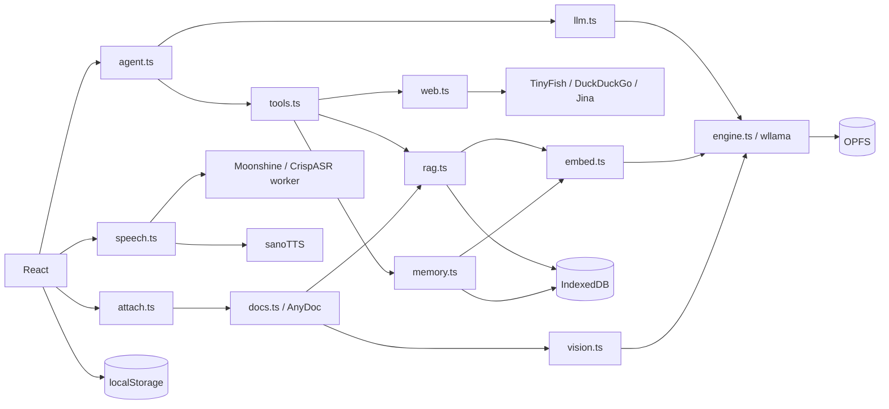

# Locus

Local Cognitive User Service. Browser-local AI chat with GGUF inference, document retrieval, tools and voice. No application server or telemetry.

https://github.com/user-attachments/assets/789e1565-a31a-4427-a358-38ad3d64f1cb

## Develop

Requires [Bun](https://bun.sh).

```bash
bun install
bun dev
bun run check
bun run build
```

Run tests individually with `bun <path>.test.ts` or `bun <path>.test.tsx` in `src/lib` and `src/components`.

## Models

| Model | Download | Capabilities |
| --- | --- | --- |
| [LFM2.5 230M](https://huggingface.co/LiquidAI/LFM2.5-230M-GGUF) | 149 MB | Chat |
| [LFM2.5 VL 450M](https://huggingface.co/LiquidAI/LFM2.5-VL-450M-GGUF) | 332 MB | Vision |
| [MiniCPM5 1B](https://huggingface.co/openbmb/MiniCPM5-1B-GGUF) | 688 MB | Thinking, tools |
| [Nasledie 0.8B](https://huggingface.co/aemmeath/NasledieLab-Qwen3.5-0.8B-GPT-6-Astra-Luna-Fable-5.1-Opus-5.5-distill-Karpy-GGUF) | 529 MB | Experimental, always thinks, tools |
| [Bonsai 2 2B](https://huggingface.co/prism-ml/Ternary-Bonsai-2-2B-gguf) | 911 MB | Vision, thinking, tools |

Downloads include image projectors where required. Settings → Models accepts a custom `.gguf` and optional `mmproj`, cached in OPFS. A new upload replaces the previous custom model. Presets and capability flags live in [models.ts](src/lib/models.ts).

Nasledie's tool reliability and browser performance are unverified. Bonsai uses Q2_0 language weights and a Q8_0 image projector; thinking is off by default. Use at least a 16K context for its 8192-token reasoning limit.

## Architecture



[engine.ts](src/lib/engine.ts) creates independent wllama workers for chat, embeddings and vision. Each owns its weights and KV cache. Chat streams text, reasoning and tool calls through llama.cpp WebAssembly on CPU or WebGPU. Pinned [runtime assets](src/assets/wllama/README.md) include Bonsai transforms missing from the npm binaries.

React 19, Vite, Tailwind 4 and Base UI provide the interface. IndexedDB stores documents, vectors and memory; localStorage stores chats and settings; OPFS caches GGUF weights.

## Processing

- **Chat:** up to three tool rounds, then an answer-only round. Per-tool `ask`, `allow` and `deny` rules persist locally. Stop aborts generation and denies pending requests.
- **Documents:** AnyDoc parses PDF, Office, text and code files. Up to 4000 characters enter the prompt directly; longer documents enter the retrieval library. Images go to a vision-capable chat model or a separate LFM2.5 VL reader.
- **Retrieval:** roughly 1000-character chunks, BM25 and mdbr-leaf-ir Q8 embeddings. A JavaScript projection maps 384 dimensions to 768, then L2-normalises. Reciprocal rank fusion with `k=60` returns four chunks. The model invokes `search_library`; long-document retrieval requires tool support.
- **Citations:** links open the original PDF beside chat and highlight the cited passage. Office and Markdown previews retain parsed text. Scanned pages retain OCR text and page numbers without word-level highlights.
- **Memory:** `save_memory` stores facts and replaces near-duplicates. Up to five relevant facts enter the system prompt; `search_memory` retrieves more. Incognito disables saving memory.
- **Web:** TinyFish search and fetch with a configured API key; DuckDuckGo through Jina as fallback. Search returns five results; fetched text is capped at 6000 characters. Tool permissions apply before requests.
- **Voice:** Moonshine Tiny Q8 transcribes English in a separate CrispASR WASM worker. sanoTTS reads replies locally with Amy, Kristin or HFC. Weights download on first use and cache locally; microphone access requires HTTPS or localhost.
- **Artifacts:** HTML and SVG previews run in an iframe without `allow-same-origin`. Chats export as Markdown or standalone HTML. Replies support KaTeX, syntax highlighting, editing, retry and branching.

## Runtime

| Setting | Default |
| --- | --- |
| Chat context | 8192 tokens, adjustable |
| Chat CPU threads | All cores; 2 for vision models |
| Embedding / vision threads | 2 |
| Embedding / vision context | 512 / 4096 tokens |
| Backend | Auto; WebGPU on NVIDIA and Apple, CPU otherwise |

Serve `dist/` with cross-origin isolation headers for threaded WebAssembly. Vite configures these during development:

```http
Cross-Origin-Opener-Policy: same-origin
Cross-Origin-Embedder-Policy: credentialless
```

Inference stays local. Model downloads and permitted web tools use external services. Retrieval scans stored vectors without an ANN index. PDF originals are excluded from chat backups; older uploads need re-uploading for original-file previews.

## License

[MIT](LICENSE) © Bharath Ajjarapu.

Read-aloud runtime [sanoTTS](https://github.com/ampixa/sanoTTS) is GPL-3.0-or-later. Dictation uses the MIT [CrisperWeaver runtime](https://github.com/CrispStrobe/CrisperWeaver/tree/ffa562b2cfd26bc0bb423255e4f832c6cd7098eb/web/wasm/crispasr-small) and pinned [Moonshine weights](https://huggingface.co/cstr/moonshine-tiny-GGUF/tree/f9d70fd5b08609291b0e1e41a69eed04e3f30009).
